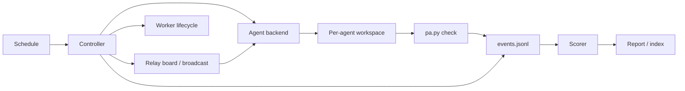

# Automating the experiment

The current conductor is a session: it creates a run, spawns agents, relays
messages, kills losers, scores, and deletes the worker.  Almost all of that is
mechanical.  The blueprint is a deterministic controller around the existing
`pa.py` / `new_run.py` / `score.py`, with agent execution behind an adapter.

## Principle

**Only the proof search is an LLM.**  Run creation, checkpoint verification,
relay, winner selection, budget enforcement, scoring and teardown are code.
The kernel check (`pa.py`) is the only judge.  An agent's prose is never a
checkpoint.

## Components



| component | responsibility | current piece |
| --- | --- | --- |
| Corpus | statements, targets, budgets, hashes | `Problems/`, `problems/manifest.json` |
| Run store | one directory per run; `run.json`, `events.jsonl` | `new_run.py`, `pa.py` |
| Compiler | remote `lake build`, type/axiom check | `pa.py` |
| Agent backend | spawn / send / wait / kill a worker | **missing adapter** |
| Controller | state machine, budgets, winner, relay | **missing** |
| Relay | board, broadcast, supervisor turns | files today; deterministic controller |
| Worker lifecycle | create / lease / delete the Cloud worker | `gcloud-worker.ts` |
| Scorer | targets, time, cost, proof size | `score.py` |
| Report | tables, index/speedup, retrospective | `results/` |

## Interfaces

```python
class AgentBackend(Protocol):
    def spawn(self, spec: AgentSpec) -> AgentHandle: ...
    def send(self, handle: AgentHandle, message: str) -> None: ...
    def wait(self, handle: AgentHandle, timeout_s: float) -> TurnResult: ...
    def kill(self, handle: AgentHandle) -> None: ...

class TurnResult:
    status: Literal["checkpoint", "done", "blocked", "crashed", "timeout"]
    output: str
    usage: dict          # tokens, cost, wall time
    events: list[dict]   # check events appended by pa.py

class Method(Protocol):
    def start(self, run: Run, backend: AgentBackend) -> None: ...
    def on_turn(self, run: Run, agent: str, result: TurnResult) -> None: ...
    def done(self, run: Run) -> bool: ...
```

The backend is the only part tied to a particular agent product: a local
subprocess, an HTTP agent service, or the OMP `task` API.  A worker is a
process/session with a workspace and a brief; the controller does not care
which model runs it.

## State machine

```
created -> worker_ready -> running -> solved | budget | crashed -> scored -> archived
```

- `created`: `new_run.py` copies statements, hashes them, writes `run.json`.
- `worker_ready`: the compiler backend answers; one worker per run (or per
  parallel lane), never a shared worker for two timed methods.
- `running`: agents are spawned; the controller watches `events.jsonl` and
  `agent` turns.
- `solved`: a `kind=check` event with every target green; stop all agents at
  once.
- `budget`: wall clock expired; stop, score partial targets.
- `crashed`: backend error or worker loss; retry once, then mark `void`.
- `scored`: `score.py` writes `summary.json`.
- `archived`: worker deleted, run directory retained.

The event log is the source of truth.  A controller restart replays it and
resumes at the last event; nothing is held only in memory.

## Method policies

| method | controller behaviour |
| --- | --- |
| S0 | one agent; hand problems in order; on `done`/`blocked` start the next; budget per problem |
| S1 | spawn N; wait for the first `solved`; kill the rest; score |
| S4 | same as S1 with N=8 |
| S2 | spawn supervisor + N workers; on a worker checkpoint, verify the event, append to board, wake supervisor; write its broadcast, wake workers; first `solved` wins |
| S3 | ask supervisor for a plan; validate the plan; spawn one worker per lemma; verify checkpoints; copy verified modules into `shared/workspace`; build the root; first green root wins |

S2/S3 supervision can be an LLM, but **the relay is code**:

- verify `kind=check`, `statement_ok`, `forbidden_fatal == []`, and the named
  targets `ok` before broadcasting;
- write the broadcast from verified declarations, not from prose;
- copy files/modules deterministically;
- never let the supervisor claim a target the event log does not show.

This removes the largest source of coordination variance while keeping the
supervisor's strategic value.

## Budget and failure handling

- Wall clock per run and per problem; the controller kills the process group
  at the deadline.
- Per-check timeout and memory cap; a killed check is an event, not a retry.
- Worker preemption: recreate from the image, replay `run.json`, resume from
  the last synced checkpoint; a run with no checkpoint is `void`.
- Agent crash: one retry with the same brief and workspace; a second failure
  is a `void` run.
- A backend error is loud: no silent local fallback.

## Isolation and anti-cheat

For a real automated system, the honour system is not enough:

- one container/namespace per agent, no network, read-only reference tree;
- only the agent's workspace writable;
- statement hashes checked at every check;
- axiom and forbidden-construct scans;
- transcript and tool-call audit stored with the run;
- no `task`/subagent tool in the worker image.

The current harness already does the statement hash, axiom check, forbidden
scan, and per-workspace isolation.  Network isolation and filesystem read-only
mounts belong in the container, not in `pa.py`.

## Reproducibility

Record in `run.json`:

- corpus and statement hashes;
- method prompt hash;
- agent model, version, temperature, and tool set;
- worker image, zone, shape, lease;
- start/end timestamps and budget;
- per-turn token usage and cost.

Agents are nondeterministic, so replay is not exact; the event log and
transcripts are the audit trail.  The check itself is deterministic.

## Scheduling and the retrospective

A scheduler chooses cells, not individual agents:

```
for repeat in range(3):
  for method in randomized(methods):
    run(method, problem, budget)
score_all()
compare()
```

- Repeat the close cells; randomize method order to spread host/load drift.
- Run parallel methods on separate workers, not on one worker, so timings are
  not confounded.
- Prefer a sequential design: finish a cell, then decide whether to repeat.
- Feed the scorer's target-level data into the decision rule already in
  `results/mid-hard-decision.md`.

For a larger campaign, a bandit could allocate the next run to the method with
the best lower confidence bound on targets/hour, but only after the harness is
stable enough that variance is method variance, not orchestration noise.

## What to automate first

1. **`expctl run`** around `new_run.py` + `pa.py` + `score.py` for S0/S1.  No
   relay, no supervisor; proves the controller and backend adapter.
2. **S2 relay** as code: board diff, event verification, broadcast, wake.
   Keep the supervisor as an optional strategy call.
3. **S3 plan/integration**: parse a plan into lemma tasks, spawn, copy
   verified modules, build the root.
4. **Worker lifecycle**: create/lease/delete around the run, with `.remote.json`
   written per run.
5. **Scheduler and dashboard**: repeats, randomized order, summary/index
   regeneration, cost per solve.

## What not to automate

- **Statement acceptance.**  A human/planner must approve a statement before
  it is used; three PCF defects were found only by attempting proofs.
- **The final method decision.**  The data can rank methods, but the choice
  between wall clock and agent cost is a policy decision.
- **Semantic judgment of a proof.**  The kernel checks the proof; an LLM
  should not be the gate.
